# Dokumentasi gabungan — Portal Data BNPB (29 September 2026)

Satu dokumen untuk paparan: **status**, **justifikasi modul**, **bukti visual (termasuk breakdown kelola)**, dan **cara implementasi step-by-step**.

| | |
| --- | --- |
| Branch | `ckanext-sdbi` + `ckan-compose`: `upgrade-ckan-security-etc` |
| Lokal | http://localhost:8080 — CKAN **2.10.11** |
| Produksi | https://data.bnpb.go.id — CKAN **2.9.11** (belum cutover) |
| Persyaratan resmi | [`PRD.md`](PRD.md) |
| Screenshot | [`screenshots/`](screenshots/) |

Dokumen terdahulu (`STATUS.md`, `HASIL.md`, `HOW-TO-IMPLEMENT.md`, `README.md`) mengarah ke file ini sebagai sumber paparan terkini.

---

## 1. Ringkas status

Update sejak 9 Sep: BPBD Kab/Kota + Provinsi di Postgres (`sdbi_bpbd`) dan tampil di peta; clustering Supercluster; FAQ + kamar Tanggap di `sdbi_settings`; harvest JSON REST di lokal.

| ID | Persyaratan | Lokal | Produksi |
| --- | --- | --- | --- |
| B0 | SQL search dimatikan | **Selesai** | **Selesai** |
| B2 | Auth SQL default tolak (`sdbi` terakhir) | **Selesai** | **Selesai** |
| B1 | CKAN 2.10.11 | **Selesai** | **Belum** |
| Fase 0 | 2FA TOTP | **Selesai** | Perlu image + `security migrate` |
| Fase 1 | Harvester JSON REST | **Selesai*** | Perlu image + worker sama |
| Fase 2 | `/sebaran-bpbd` | **Selesai** | Belum deploy |
| Fase 3 | `/bantuan` | **Selesai** | Belum deploy |
| Fase 4 | `/tanggap-darurat` + embed dinamis | **Selesai** | Perlu cutover 2.10 |

\*JSON REST mendukung API dengan pola URL mirip CKAN; bukan harvester generik sembarang JSON.

### Lingkungan

| | CKAN | Image / Solr |
| --- | --- | --- |
| Produksi | 2.9.11 | `ghcr.io/keitaroinc/ckan:2.9.11-focal` |
| Lokal | 2.10.11 | `ckan/ckan-base:2.10.11-py3.10` + `ckan/ckan-solr:2.10-solr9` |

### Verifikasi lokal (29 Sep 2026)

| Pemeriksaan | Hasil |
| --- | --- |
| `status_show` | 2.10.11; `activity`, `sdbi_json_harvester`; `sdbi` terakhir |
| `/sebaran-bpbd` | ~477 titik (443 kab + 34 prov); cluster zoom; unduh CSV |
| `/bantuan` + `/bantuan/kelola` | Publik 200; kelola sysadmin (anon 403) |
| `/tanggap-darurat` + `/kelola` | Dropdown navbar; kelola JSON iframe HTTPS |
| `/data/<link>` | Embed dari `sdbi_embed_pages` |
| `datastore_search_sql` | Tidak terdaftar / tertahan |

---

## 2. Justifikasi: kenapa modul embed dinamis (bukan “tambah folder di root”)

### Pertanyaan yang sering muncul

> Di Windows Server / IIS, cukup buat folder di root situs, taruh HTML, selesai. Kenapa di portal CKAN harus ada **modul** embed link?

### Perbedaan platform

| | Windows Server (IIS static / folder) | Portal Data BNPB (CKAN) |
| --- | --- | --- |
| Model hosting | File di disk dilayani langsung oleh web server | Aplikasi Python (Flask/Pylons) + routing terdaftar |
| “Tambah folder di root” | Bisa jadi URL publik otomatis | Folder di container/image **tidak** otomatis jadi rute CKAN |
| Navbar / auth / tema | Terpisah atau hard-code HTML | Harus lewat plugin + template CKAN |
| Ubah konten darurat | Edit file / salin folder baru | Sysadmin isi URL lewat UI; tanpa rebuild image |
| Keamanan iframe | Tergantung konfigurasi IIS | Kebijakan eksplisit: HTTPS saja, validasi URL, 403 non-sysadmin untuk kelola |

### Apa yang disediakan modul `sdbi`

1. **Kamar Tanggap Darurat** (`/tanggap-darurat?jenis=…`)  
   Dropdown navbar per jenis bencana. URL dashboard (Superset, GIS, ArcGIS, dll.) disimpan di Postgres `sdbi_settings` key `tanggap_rooms`. Sysadmin ubah di `/tanggap-darurat/kelola`.

2. **Halaman embed dinamis** (`/data/<link>`)  
   Baris di tabel `sdbi_embed_pages` (`link`, `title`, `src_url`). Portal hanya meng-iframe URL yang sudah terdaftar — cocok untuk dashboard one-off tanpa menambah kamar navbar.

3. **FAQ Bantuan** (`/bantuan`)  
   Konten di `sdbi_settings.faq`; edit di `/bantuan/kelola`. Bukan artikel CKAN Pages statis.

### Mengapa tidak cukup “drop folder”

- CKAN memproses hampir semua path lewat aplikasi. Static di `/srv/app/...` hanya untuk asset yang sudah di-mount/dikonfigurasi, bukan “situs baru” per folder.
- Produksi memakai **image Docker**. Menambah folder di host tanpa rebuild/deploy terkontrol mudah hilang saat recreate container.
- Event bencana butuh **cepat ganti URL** tanpa minta DevOps rebuild. Modul + DB memenuhi itu.
- Portal **tidak menyimpan** dashboard — hanya embed. Syarat HTTPS + izin iframe (`frame-ancestors` / tidak `X-Frame-Options: DENY`) tetap di sisi penyedia dashboard (lihat `/tanggap-darurat/panduan`).

### Ringkas justifikasi (satu kalimat paparan)

> Modul embed dinamis ada supaya petugas bisa menambah/mengganti dashboard tanggap darurat lewat URL terdaftar di portal CKAN, tanpa mengandalkan pola “folder di root” ala Windows Server yang tidak berlaku di arsitektur container + aplikasi CKAN.

---

## 3. Hasil visual + breakdown

Capture lokal 29 Sep 2026. Zoom browser ~80% agar konten tidak kepotong.

### Checklist persyaratan → screenshot

| ID | Persyaratan | Screenshot |
| --- | --- | --- |
| B0 | SQL search off | [`07-b0-sqlsearch-disabled.png`](screenshots/07-b0-sqlsearch-disabled.png) |
| B1 | CKAN 2.10.11 | [`05-status-show.png`](screenshots/05-status-show.png) |
| Fase 0 | 2FA | [`06-fase0-2fa-login.png`](screenshots/06-fase0-2fa-login.png) |
| Fase 1 | Harvest JSON REST | [`04-harvest.png`](screenshots/04-harvest.png) |
| Fase 2 | Peta BPBD | [`01-sebaran-bpbd-all.png`](screenshots/01-sebaran-bpbd-all.png) |
| Fase 3 | Bantuan | [`02-bantuan-hero.png`](screenshots/02-bantuan-hero.png) |
| Fase 3 | **Kelola FAQ** | [`bantuan-kelola.png`](screenshots/bantuan-kelola.png) |
| Fase 4 | Tanggap Darurat | [`03-tanggap-darurat.png`](screenshots/03-tanggap-darurat.png) |
| Fase 4 | **Kelola kamar / iframe** | [`tanggap-darurat-kelola.png`](screenshots/tanggap-darurat-kelola.png) |

### B0 — SQL search dimatikan

Env: `CKAN__DATASTORE__SQLSEARCH__ENABLED=false`. Aksi SQL tidak dikenal.

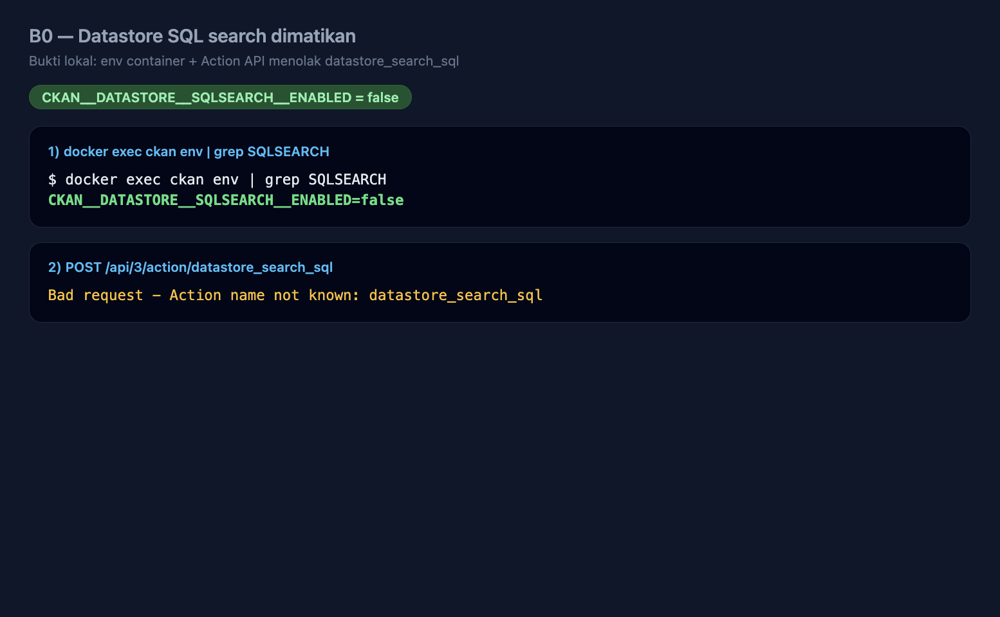

### B1 — Versi CKAN

`GET /api/3/action/status_show` → lokal **2.10.11**.

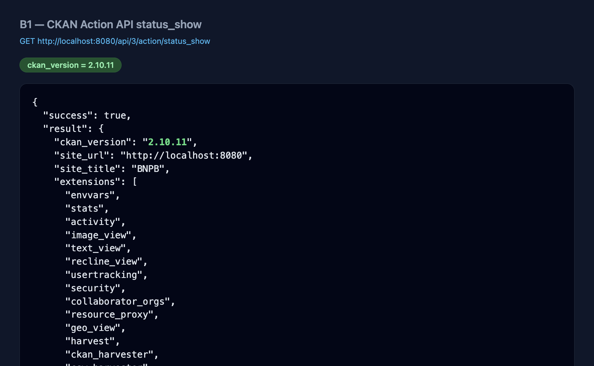

### Fase 0 — 2FA

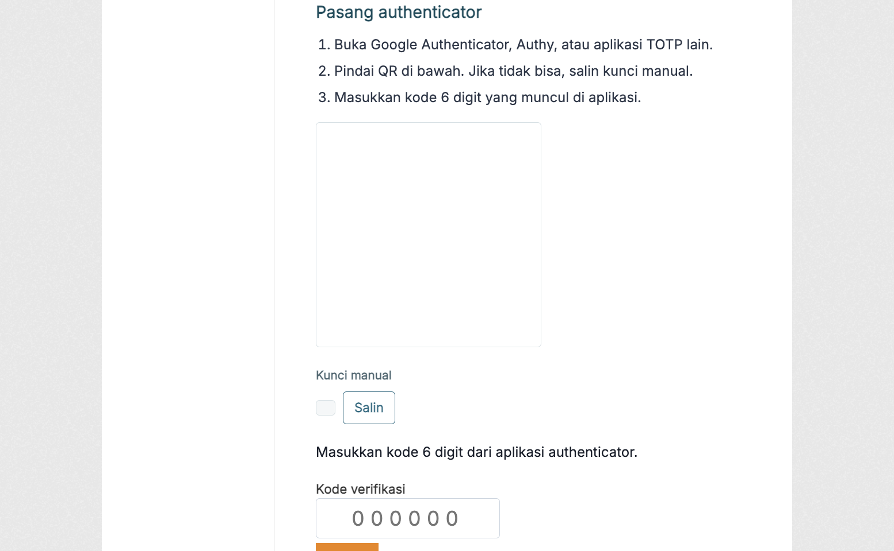

### Beranda

Navbar: **Peta BPBD**, **Tanggap Darurat** (dropdown), **Bantuan**.

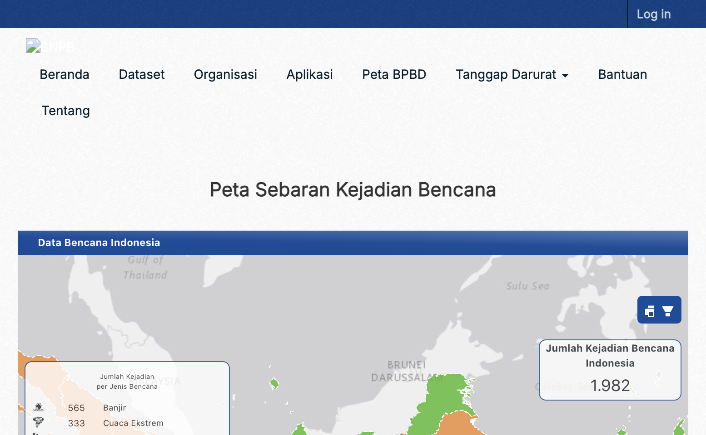

### Fase 2 — `/sebaran-bpbd`

~477 lokasi (443 Kab/Kota + 34 Provinsi berkoordinat). Clustering: zoom-out angka grup, zoom-in titik. 4 Provinsi tanpa koordinat tidak di-plot.

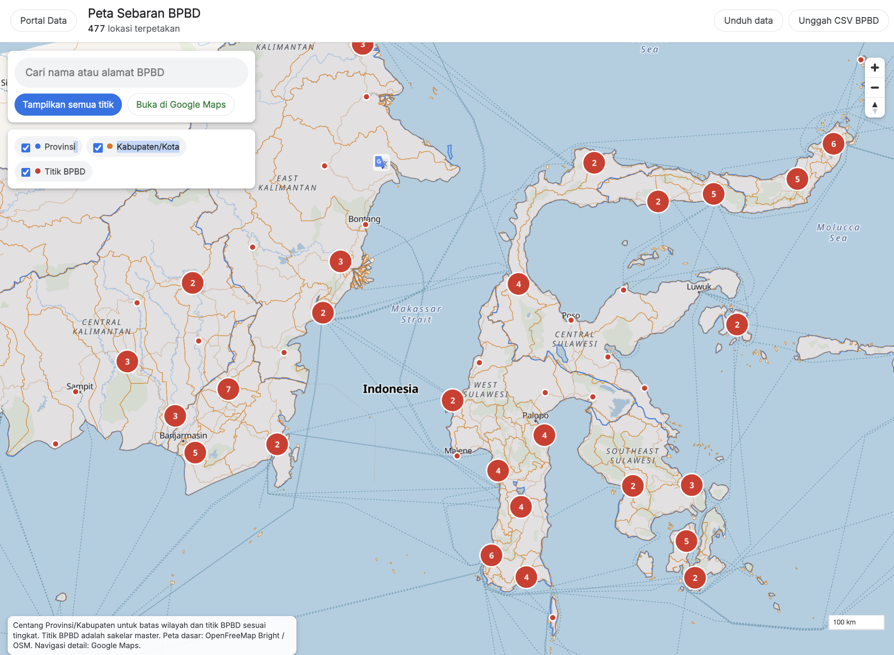

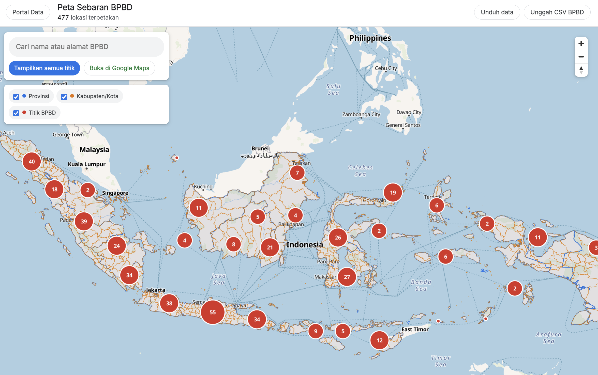

### Fase 3 — `/bantuan` (breakdown)

**Publik:** FAQ collapsible, chip kategori, pencarian.

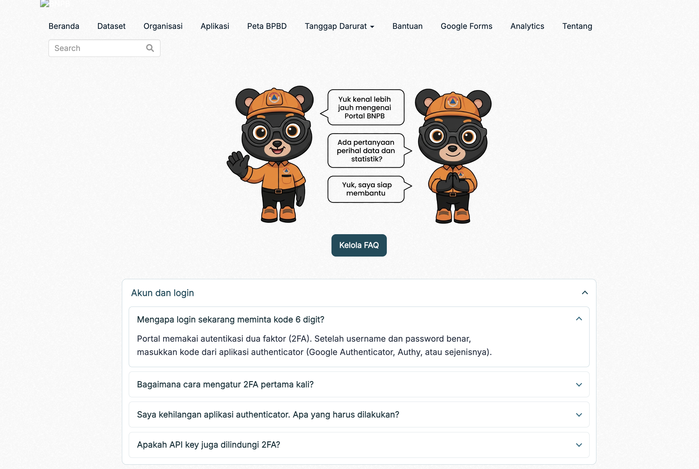

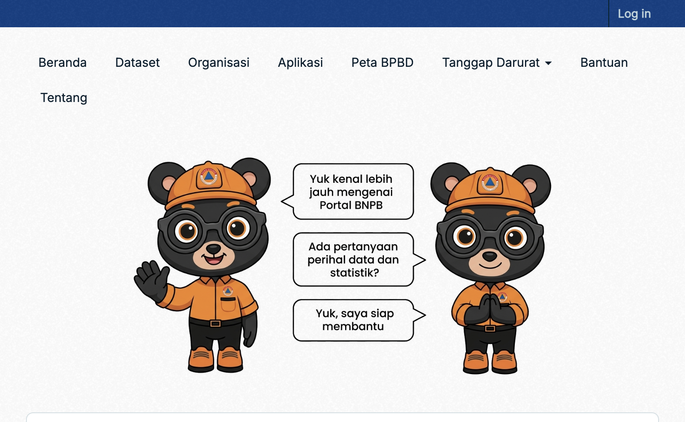

**Kelola (sysadmin):** edit JSON FAQ di `sdbi_settings.faq` tanpa rebuild image. Anonim → 403.

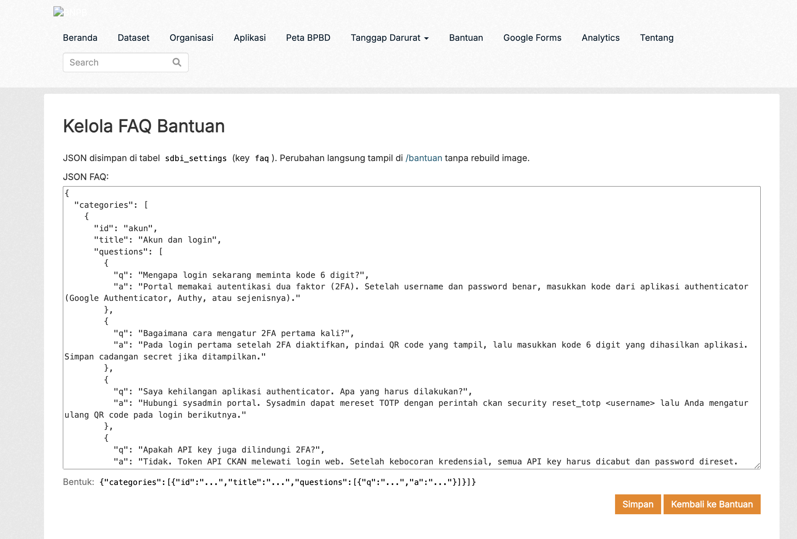

### Fase 4 — `/tanggap-darurat` (breakdown)

**Publik:** kamar dipilih dari **dropdown navbar** (bukan dropdown di dalam halaman). Iframe HTTPS atau pesan kamar kosong.

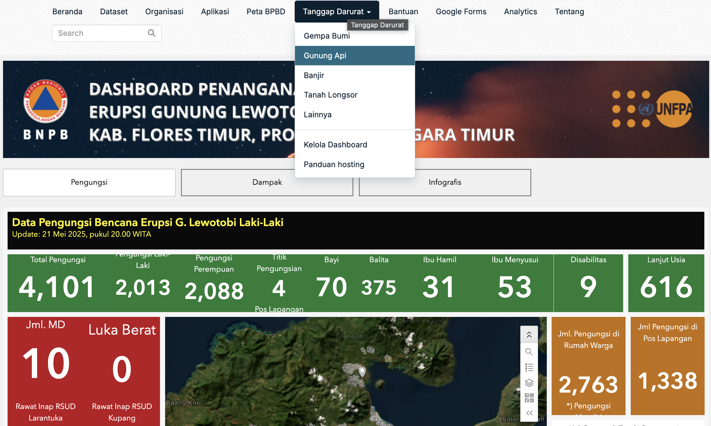

**Kelola (sysadmin):** JSON `tanggap_rooms` — slug, label, `iframe_url` HTTPS, sumber. Perubahan langsung tampil tanpa rebuild.

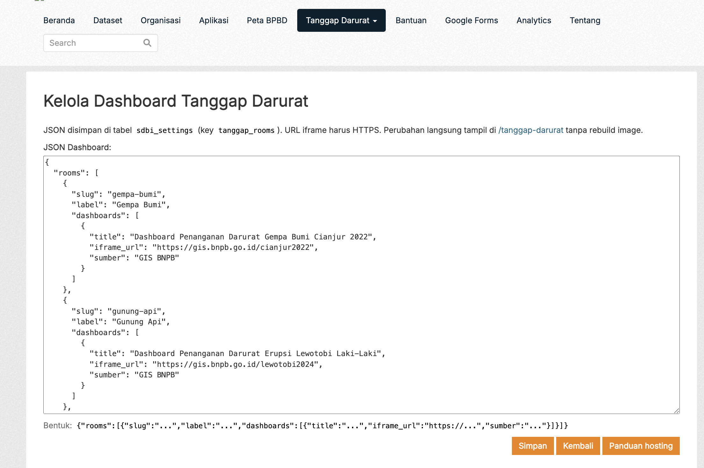

**Terkait (tetap ada):** `/gempantt2026` (URL saja, tidak di navbar); `/data/<link>` dari `sdbi_embed_pages`.

### Fase 1 — `/harvest`

Tipe **JSON REST**. Frequency MANUAL perlu Reharvest / `ckan harvester job`.

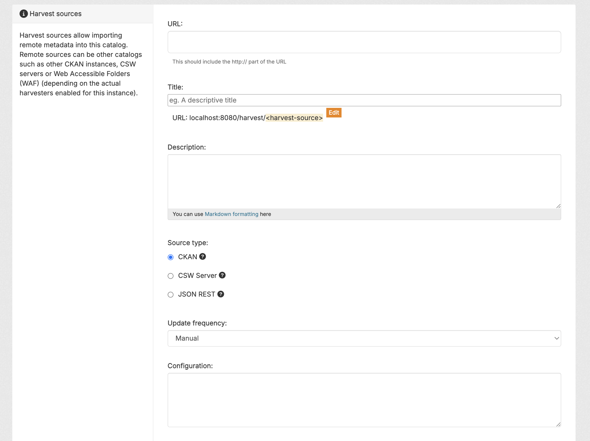

### Poin bicara slide

| Slide | Gambar | Poin |
| --- | --- | --- |
| B0 | `07-…` | Env false; aksi SQL tidak dikenal |
| B1 | `05-…` | Lokal 2.10.11 vs produksi 2.9.11 |
| 2FA | `06-…` | TOTP / QR |
| Peta | `01-sebaran-bpbd-all` | Kab + Provinsi; cluster |
| Bantuan | `02-bantuan-hero` + `bantuan-kelola` | FAQ DB + kelola sysadmin |
| Tanggap | `03-…` + `tanggap-darurat-kelola` | Navbar + embed dinamis (bukan folder root) |
| Harvest | `04-…` | JSON REST; batasan pola URL |

---

## 4. How-to implementasi (step-by-step)

CLI: `docker-compose`. Context Docker lokal: `colima-ckan`. Jaga `CKAN__DATASTORE__SQLSEARCH__ENABLED=false` sepanjang proses.

### A. Lokal (sudah jalan)

```bash
cd ckan-compose
docker-compose -f docker-compose.yml -f docker-compose.dev.yml up -d
```

| Layanan | Peran |
| --- | --- |
| `ckan` | Web :8080 |
| `ckan-harvest-gather` / `fetch` / `run` | Job harvest (image **sama** dengan web) |
| `solr` | `ckan/ckan-solr:2.10-solr9` |
| `db`, `redis` | Postgres + Redis |

Worker harvest wajib memuat `CKAN__PLUGINS` yang sama (termasuk `sdbi_json_harvester`). Tanpa itu: `No harvester could be found for source type sdbi_json_harvester`.

#### Plugin: lokal vs produksi

| Hanya lokal | Alasan |
| --- | --- |
| `activity` | Wajib di 2.10 |
| `sdbi_json_harvester` | JSON REST |

| Hanya produksi 2.9 | Alasan |
| --- | --- |
| `resourceauthorizer` | Jangan di 2.10 (Pylons) |
| `dcat*` / `structured_data` | Belum di target 2.10 lokal |

`sdbi` **selalu terakhir**.

#### Rute fitur Fase 2–4

| Rute | Isi |
| --- | --- |
| `/sebaran-bpbd` | Peta MapLibre; unduh/unggah CSV (sysadmin) |
| `/bantuan` | FAQ dari DB |
| `/bantuan/kelola` | Sysadmin edit FAQ |
| Navbar Tanggap Darurat | Dropdown kamar |
| `/tanggap-darurat?jenis=<slug>` | Iframe HTTPS kamar |
| `/tanggap-darurat/kelola` | Sysadmin edit kamar |
| `/tanggap-darurat/panduan` | Syarat embed (sysadmin) |
| `/data/<link>` | Embed dinamis `sdbi_embed_pages` |
| `/gempantt2026` | GIS khusus; tidak di navbar |

#### Setelah ubah template / Python lokal

```bash
cd ckan-compose
docker-compose restart ckan
# atau: docker exec ckan touch /srv/app/src/ckanext-sdbi/ckanext/sdbi/plugin.py
```

Naikkan `?v=` di CSS/JS jika cache browser bandel. Jangan `up --build` kecuali Dockerfile berubah.

#### Harvest JSON REST (ringkas)

1. Buat sumber tipe **JSON REST** di `/harvest`.
2. URL = endpoint detail JSON (atau template daftar + `{name}`).
3. Frequency **MANUAL** → tekan **Reharvest** atau  
   `docker exec ckan ckan -c /srv/app/ckan.ini harvester job <nama-sumber>`.
4. Hasil: paket `sdbi-*` + resource tautan JSON; `data[]` **tidak** ke DataStore.

### B. Sebelum cutover (produksi 2.9 — sekarang)

1. **Cabut semua API key** pengguna 2.9; putar token DataPusher; recreate `ckan` (+ datapusher). 2FA web **tidak** melindungi API key.
2. **Jeda harvest katalog penuh** (contoh Integrasi Kota Malang); hapus paket non-bencana.
3. Konfirmasi B0 tetap false:

```bash
docker exec ckan env | grep SQLSEARCH
curl -sS 'https://data.bnpb.go.id/api/action/help_show?name=datastore_search_sql'
```

### C. Staging / produksi → 2.10.11

#### Env wajib

| Key | Nilai |
| --- | --- |
| `CKAN__DATASTORE__SQLSEARCH__ENABLED` | `false` |
| `CKAN__PLUGINS` | … harvest … `sdbi_json_harvester` … **`sdbi` terakhir**; tanpa `resourceauthorizer` |
| `CKAN__DATAPUSHER__API_TOKEN` | Token sungguhan |
| `CKANEXT__SECURITY__REDIS__DB` | **2** (bukan DB 1 CKAN) |
| `CKAN__WEBASSETS__PATH` | `/var/lib/ckan/webassets` |

#### Build & boot

```bash
docker-compose build
docker-compose up -d
docker exec ckan ckan -c /srv/app/ckan.ini db upgrade
docker exec ckan ckan -c /srv/app/ckan.ini security migrate
docker exec ckan ckan -c /srv/app/ckan.ini search-index rebuild
```

Produksi: **jangan** andalkan `pip install -e`. Plugin harus ter-bake; worker = image web yang sama.

#### Checklist staging

- [ ] Login + 2FA (QR pertama)
- [ ] `/sebaran-bpbd`, `/bantuan`, dropdown Tanggap, satu kamar
- [ ] `/bantuan/kelola` & `/tanggap-darurat/kelola` hanya sysadmin
- [ ] `/harvest` tipe JSON REST; Reharvest → `sdbi-*`
- [ ] `harvesters_info` di **gather** memuat JSON REST
- [ ] SQL search tetap mati; DataPusher token baru; harvest katalog penuh dijeda

#### Cutover produksi (maintenance)

1. Backup DB + volume; maintenance bila perlu.
2. `db upgrade` → Solr 9 volume baru → `search-index rebuild`.
3. `security migrate` **sebelum** login pengguna.
4. Recreate web **dan** worker dari image sama.
5. Cabut JWT 2.10; putar DataPusher; ulang checklist terhadap `https://data.bnpb.go.id`.
6. Tahan job harvest sampai worker image baru siap.

#### Mode gagal yang sudah diketahui

| Gejala | Cek |
| --- | --- |
| Login 500 | Redis security host/port/db |
| jQuery hilang | `CKAN__WEBASSETS__PATH` |
| Detail dataset 500 | Plugin `activity` |
| QR tanpa JS | `fanstatic/` security di image |
| Harvester tidak ketemu | Worker tanpa `CKAN__PLUGINS` / image lama |
| Unhealthy tapi situs 200 | Healthcheck pakai `wget`, bukan `curl` |

Reset TOTP: `docker exec ckan ckan -c /srv/app/ckan.ini security reset-totp <username>`

#### Urutan penerapan

1. B0 produksi — **selesai**  
2. B2 produksi (`sdbi` terakhir / auth SQL tolak) — **selesai**  
3. B1 staging → image produksi 2.10.11  
4. Fase 0/1 di image (web + worker)  
5. Fase 2–4 ikut image yang sama  

---

## 5. Risiko dan langkah berikutnya

| Item | Catatan |
| --- | --- |
| Produksi masih 2.9.11 | CVE sampai cutover B1; B0 kunci sekarang |
| 4 BPBD Provinsi tanpa koordinat | Minor; sisanya sudah di peta |
| JSON REST bukan generik | Sesuaikan template URL per portal kota |
| Kamar Tanggap kosong | Isi iframe di `/tanggap-darurat/kelola` |
| API key lama | Cabut sekarang; cabut JWT lagi setelah 2.10 |
| Harvest katalog tanpa saring | Jeda; hapus paket non-bencana |

**Next produksi:** cabut key → jeda harvest kotor → staging 2.10 → maintenance cutover → jangan nyalakan SQL search.

---

## 6. Di luar lingkup sampai diminta

- WAF/nginx block khusus path SQL  
- Lompat ke CKAN 2.11  
- Nyalakan kembali SQL search  
- Keycloak / 2FA kustom di sdbi  
- Salin `data[]` harvest ke DataStore  
- Pasang DCAT produksi di 2.10  
