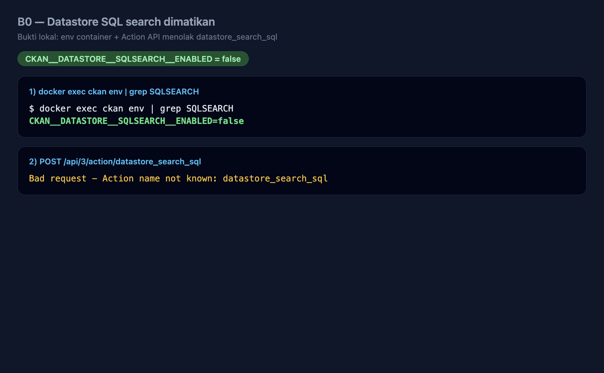
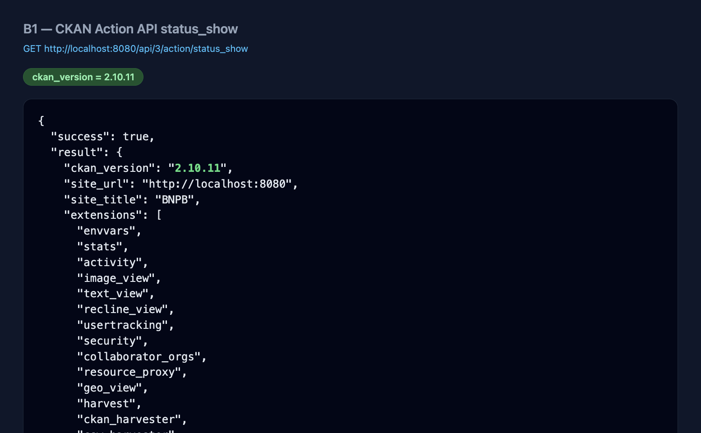
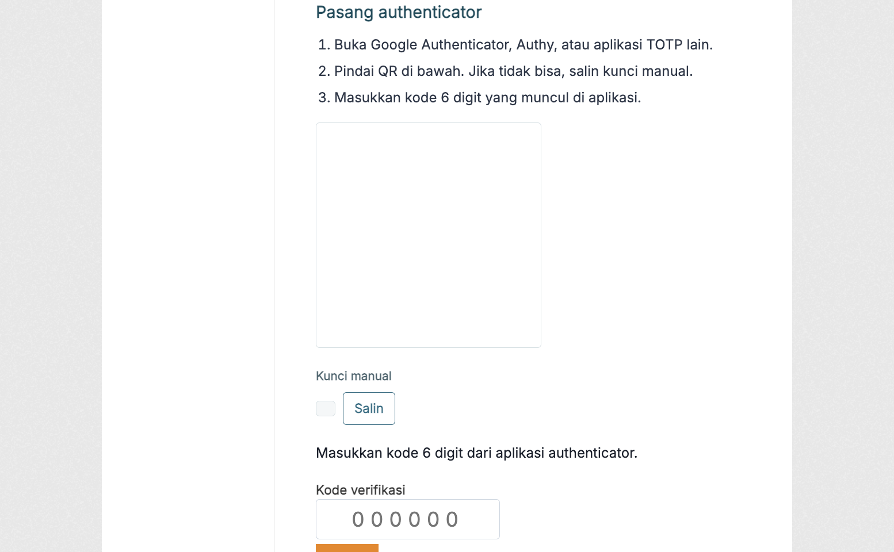
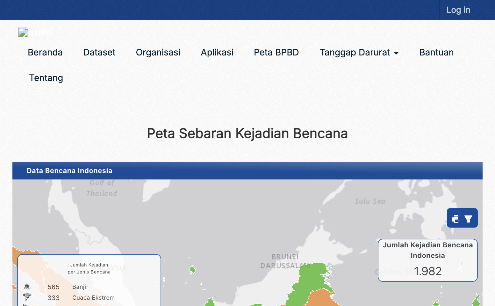
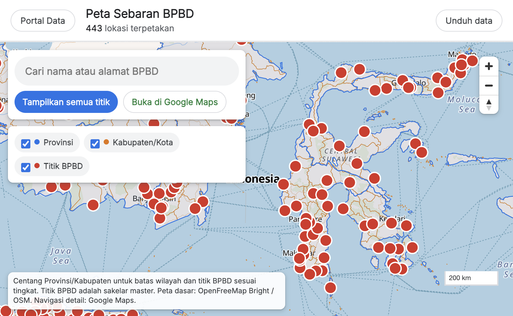
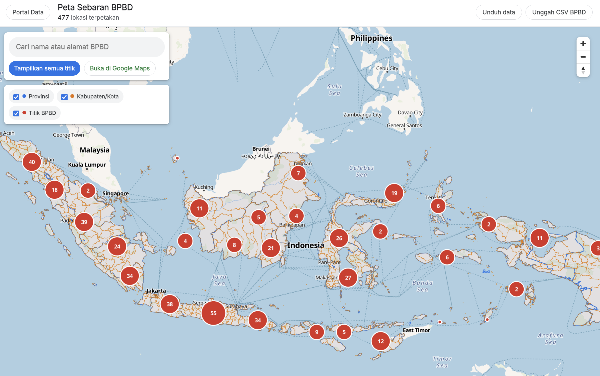
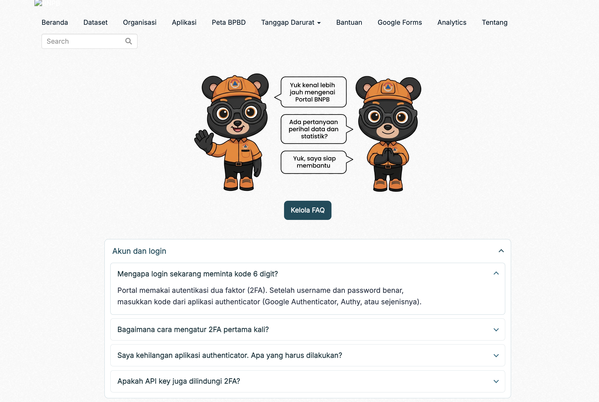
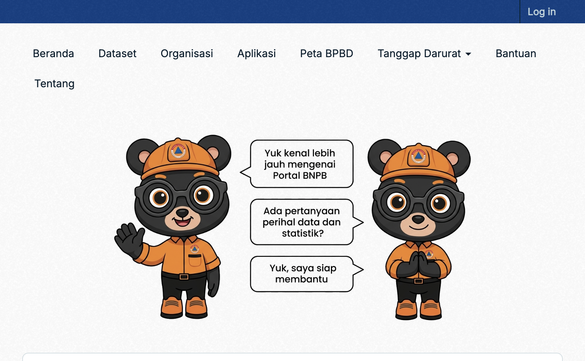
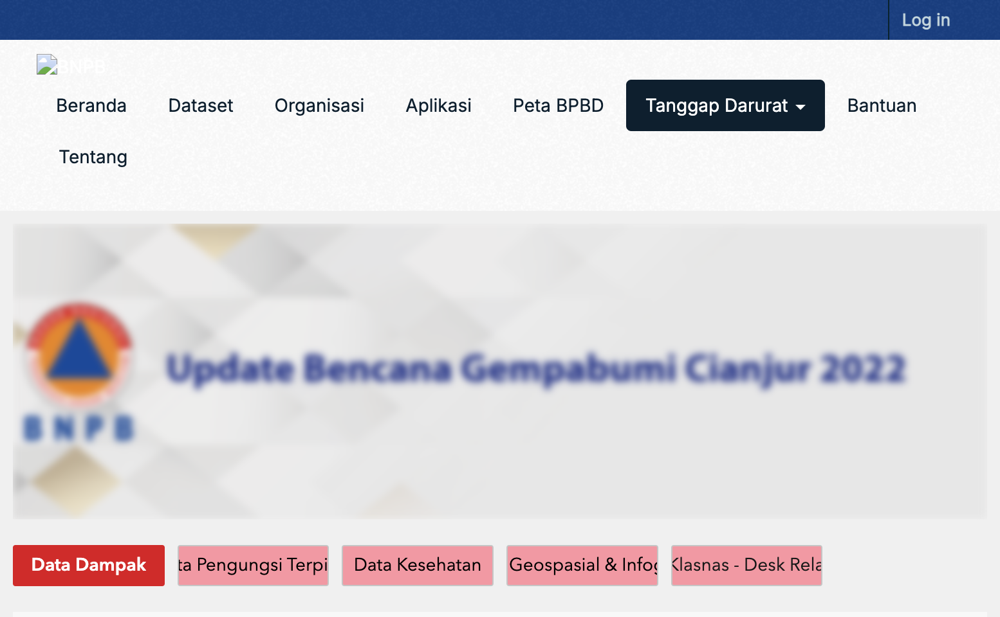
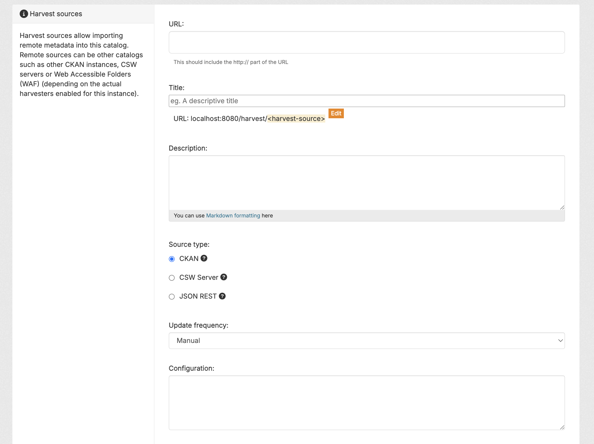

# Hasil visual — Upgrade Portal Data BNPB (lokal)

Lampiran screenshot untuk paparan. Status teks: [`STATUS.md`](STATUS.md).

URL lokal: http://localhost:8080 — diambil 29 September 2026.  
Capture browser memakai **zoom ~80%** supaya konten tidak kepotong.

## Cara capture ulang (opsional)

1. Pastikan stack compose jalan (`ckan` healthy).
2. Buka halaman di browser; set zoom **80%** (`Cmd+-` sampai ~80%).
3. Screenshot (macOS: `Cmd+Shift+4` / `Cmd+Shift+5`).
4. Simpan ke `screenshots/` dengan nama yang sama agar tautan di bawah tetap valid.

---

## Checklist Status persyaratan

| ID | Persyaratan | Screenshot |
| --- | --- | --- |
| B0 | `CKAN__DATASTORE__SQLSEARCH__ENABLED=false` | [`07-b0-sqlsearch-disabled.png`](screenshots/07-b0-sqlsearch-disabled.png) |
| B1 | CKAN 2.10.11 | [`05-status-show.png`](screenshots/05-status-show.png) |
| B2 | Auth SQL / `sdbi` terakhir di plugins | terlihat di `extensions` pada `05-status-show.png` (plugin `sdbi` di akhir list) |
| Fase 0 | 2FA TOTP | [`06-fase0-2fa-login.png`](screenshots/06-fase0-2fa-login.png) |
| Fase 1 | Harvester JSON REST | [`04-harvest.png`](screenshots/04-harvest.png) |
| Fase 2 | `/sebaran-bpbd` | [`01-sebaran-bpbd-all.png`](screenshots/01-sebaran-bpbd-all.png) |
| Fase 3 | `/bantuan` | [`02-bantuan-hero.png`](screenshots/02-bantuan-hero.png) |
| Fase 4 | `/tanggap-darurat` | [`03-tanggap-darurat.png`](screenshots/03-tanggap-darurat.png) |

---

## B0 — SQL search dimatikan

Env container: `CKAN__DATASTORE__SQLSEARCH__ENABLED=false`.  
`POST /api/3/action/datastore_search_sql` → **Action name not known**.

---

## B1 — Versi CKAN (`status_show`)

Endpoint: `GET /api/3/action/status_show`  
Lokal: **`ckan_version`: `2.10.11`** (produksi masih 2.9.11).

---

## Fase 0 — 2FA TOTP (`/user/login`)

Login memakai alur MFA: QR authenticator + kode 6 digit (plugin `security`).

---

## 0. Beranda

Navbar: **Peta BPBD**, **Tanggap Darurat** (dropdown), **Bantuan**.

---

## Fase 2 — `/sebaran-bpbd`

**~477 lokasi terpetakan** (443 Kab/Kota + 34 Provinsi berkoordinat, dari Postgres).  
4 baris Provinsi di CSV belum punya koordinat (tidak tampil di peta).

Fit semua titik Indonesia:

---

## Fase 3 — `/bantuan`

FAQ collapsible + hero mascot.

---

## Fase 4 — `/tanggap-darurat`

Kamar per jenis bencana lewat dropdown navbar.

---

## Fase 1 — `/harvest` (JSON REST)

Sumber termasuk `jakarta1`, `Fase 1 JSON REST mock`.  
**Catatan:** pola URL selaras CKAN (bukan harvester generik sembarang JSON).

---

## Ringkas untuk slide

| Slide | Gambar | Poin bicara |
| --- | --- | --- |
| B0 SQLSEARCH | `07-b0-sqlsearch-disabled.png` | Env false; aksi SQL tidak dikenal |
| B1 versi | `05-status-show.png` | Lokal 2.10.11; produksi 2.9.11 |
| Fase 0 2FA | `06-fase0-2fa-login.png` | TOTP / QR di login |
| Peta BPBD | `01-sebaran-bpbd-all.png` | 443 titik Kab/Kota; Provinsi TBD |
| Bantuan | `02-bantuan-hero.png` | FAQ searchable, konten di DB |
| Tanggap | `03-tanggap-darurat.png` | Kamar via navbar |
| Harvest | `04-harvest.png` | JSON REST; batasan format URL |
